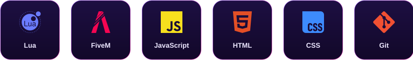

<!-- Header banner -->

  

<!-- Typing animation -->

  

<!-- Link badges -->

  
  

 

## 👋 About us

**Neutral Studios** builds FiveM scripts that bring top-tier quality to your server.

| | |
|---|---|
| ⚡ **Performance first** | Low resmon, clean code, nothing running when it doesn't need to |
| 🛠️ **Easy to set up** | Simple configs and clear instructions, so you're live in minutes |
| 🎁 **Free and premium** | Releases for every server, all on our [store](https://store.neutral-studios.com) |
| 💬 **Real support** | Questions or problems? [Email us](mailto:support.neutralstudios@gmail.com) |

 

## 🧰 Tech stack

  

 

## 📊 Languages

  

Updated automatically every day from our public repositories.

 

<!-- Contribution snake (built by .github/workflows/profile.yml) -->

  <picture>
    <source media="(prefers-color-scheme: dark)" srcset="https://raw.githubusercontent.com/NeutralStudios/NeutralStudios/output/github-snake-dark.svg" />
    
  </picture>

  

<!-- Footer banner -->

  

